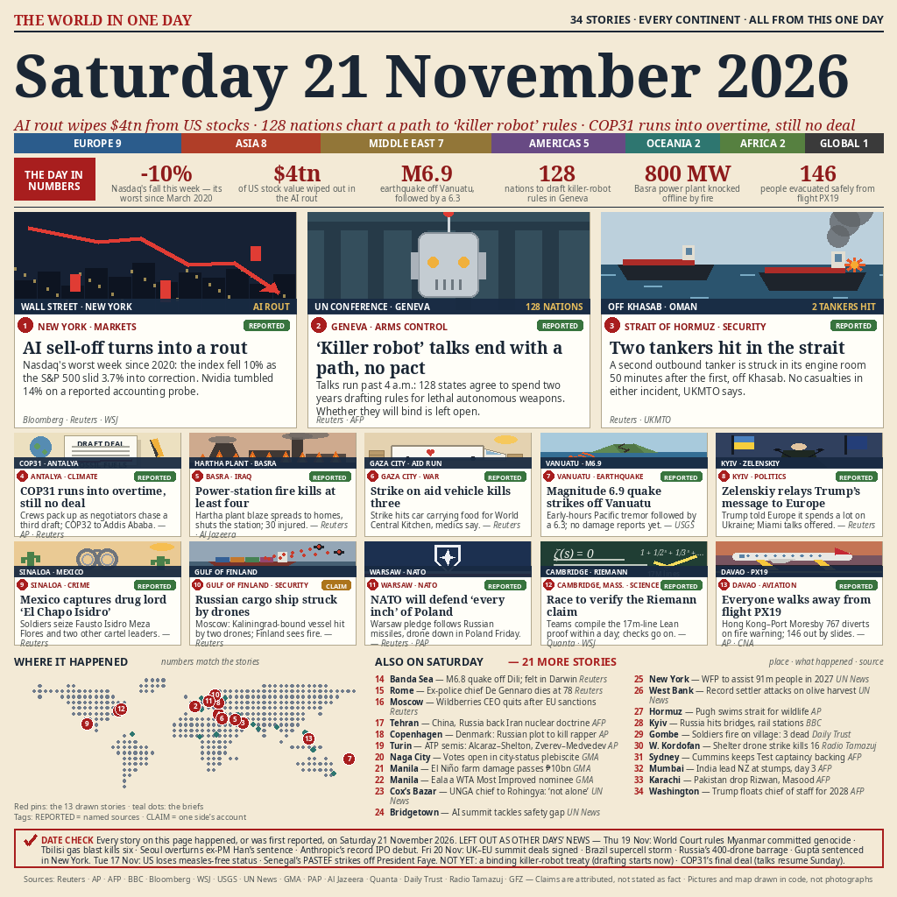

# 21 November 2026 — The World in One Day

[](https://make.fun/bounty/news-image-20261121?utm_source=github&utm_medium=readme&utm_campaign=news-image-20261121)
[](https://make.fun/bounty/news-image-20261121/leaderboard?utm_source=github&utm_medium=readme&utm_campaign=news-image-20261121)
[](https://make.fun/bounty/news-image-20261121?utm_source=github&utm_medium=readme&utm_campaign=news-image-20261121)



One 1024×1024 newspaper front page that sums up a single day of world
news — **Saturday 21 November 2026** — in **34 stories**: a masthead and
standfirst, a region tally (Europe 9 · Asia 8 · Middle East 7 ·
Americas 5 · Oceania 2 · Africa 2 · Global 1), the day in numbers,
**13 drawn story cards**, a *Where It Happened* map whose numbered pins
match the cards, **21 one-line briefs**, and a red **Date Check** box
that lists what was left out as other days' news. Every picture — the
scenes and the map alike — is drawn in code; no photographs are used.

## The 13 drawn stories

1. **New York · Markets — AI sell-off turns into a rout.** Nasdaq's
   worst week since 2020 (−10%); the S&P 500 slides 3.7% into
   correction; Nvidia tumbles 14% on a reported accounting probe; $4tn
   wiped from US stocks. *Bloomberg · Reuters · WSJ*
2. **Geneva · Arms control — 'Killer robot' talks end with a path, no
   pact.** Talks run past 4 a.m.; 128 states agree to spend two years
   drafting rules for lethal autonomous weapons, binding or not.
   *Reuters · AFP*
3. **Strait of Hormuz · Security — Two tankers hit in the strait.** A
   second outbound tanker is struck in its engine room 50 minutes
   after the first, off Khasab, Oman; no casualties. *Reuters · UKMTO*
4. **Antalya · Climate — COP31 runs into overtime, still no deal.**
   Crews pack up as negotiators chase a third draft; COP32 goes to
   Addis Ababa in 2027. *AP · Reuters*
5. **Basra · Iraq — Power-station fire kills at least four.** The
   Hartha plant blaze spreads to homes and shuts the 800 MW station;
   30 injured. *Reuters · Al Jazeera*
6. **Gaza City · War — Strike on aid vehicle kills three.** A car
   carrying food for World Central Kitchen is hit, medics say.
   *Reuters*
7. **Vanuatu · Earthquake — Magnitude 6.9 quake strikes off Vanuatu.**
   The early-hours Pacific tremor is followed by a 6.3. *USGS*
8. **Kyiv · Politics — Zelenskiy relays Trump's message to Europe.**
   Trump told Europe it spends a lot on Ukraine; Miami G20 talks
   offered. *Reuters*
9. **Sinaloa · Crime — Mexico captures drug lord 'El Chapo Isidro'.**
   Soldiers seize Fausto Isidro Meza Flores and two other cartel
   leaders. *Reuters*
10. **Gulf of Finland · Security — Russian cargo ship struck by
    drones.** Moscow says a Kaliningrad-bound vessel was hit by two
    drones; Finland reports it on fire. *Reuters* — tagged CLAIM.
11. **Warsaw · NATO — NATO will defend 'every inch' of Poland.**
    Rutte's pledge follows Russian missiles and a drone down in
    Poland on Friday. *Reuters · PAP*
12. **Cambridge, Mass. · Science — Race to verify the Riemann claim.**
    Teams compile the 17-million-line Lean proof within a day;
    checks go on. *Quanta · WSJ*
13. **Davao · Aviation — Everyone walks away from flight PX19.** The
    Hong Kong–Port Moresby 767 diverts on an engine fire warning;
    all 146 leave by the slides. *AP · CNA*

Stories 14–34 run as one-line briefs along the bottom — from a second
big quake in the Banda Sea to Pakistan's contract overhaul — each with
its place and source named.

## Date discipline

Every story on the page happened, or was first reported, on Saturday
21 November 2026 (in some time zone), cross-checked against named
sources before it was drawn. The Date Check box names the day's
biggest traps that were **left out as other days' news**: the World
Court's Myanmar genocide ruling, the Tbilisi gas blast and South
Korea's Han verdict (Thu 19 Nov); the UK–EU summit deals, the Brazil
supercell storm, Russia's 400-drone barrage and the Gupta sentencing
(Fri 20 Nov); the measles-status revocation and Senegal's PASTEF
decision (Tue 17 Nov).

## How it was made

`tools/compose.py` draws the entire page programmatically with PIL —
masthead, tally bar, number strip, the 13 flat-vector scenes, the
dot-grid world map with its pins, all headlines, summaries, briefs
and the date-check box — and writes `entry.png`. Rebuild it with:

```sh
python3 tools/compose.py
```

(An earlier six-panel edition of this entry used painted scenes kept
in `art/`; the front-page edition is drawn entirely in code and does
not use them.)

## Run it

```sh
bun run main.ts
```

`main.ts` verifies `entry.png` against the intake limits (PNG
signature, IHDR dimensions at most 1024×1024, at most 1 MiB), stages
it into `$MAKEFUN_OUTPUT_DIR` (falling back to `/output`, since the
repository is mounted read-only), and confirms the staged copy is
byte-identical by SHA-256.

## License

MIT — see [LICENSE](LICENSE).
